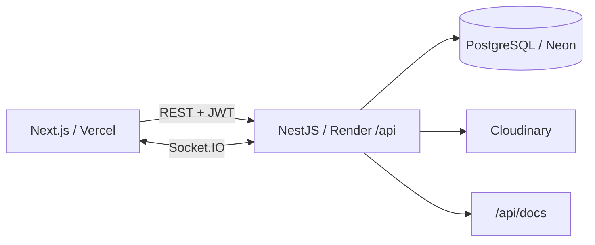

# HiVibe

Mini red social académica: perfiles, publicaciones con imágenes, likes, comentarios, seguimiento, feed, chat privado y notificaciones en tiempo real.

## Estado

Frontend desplegado en Vercel, API en Render, PostgreSQL en Neon e imágenes en Cloudinary. También puede ejecutarse con Docker local. Las direcciones localhost son exclusivamente de desarrollo. El PDF de entrega sigue pendiente.

| Recurso | Dirección |
|---|---|
| Repositorio | https://github.com/gesteb3/hivibe |
| API local / health | http://localhost:4300/api/health |
| Swagger local | http://localhost:4300/api/docs |
| OpenAPI JSON local | http://localhost:4300/api/docs-json |
| Frontend público | https://hivibe-web.vercel.app |
| Backend público | https://hivibe.onrender.com |
| Health público | https://hivibe.onrender.com/api/health |
| Swagger público | https://hivibe.onrender.com/api/docs |
| OpenAPI JSON público | https://hivibe.onrender.com/api/docs-json |

## Tecnologías y arquitectura

NestJS, TypeScript, PostgreSQL 17, Prisma 7, Argon2id, JWT HS256, Socket.IO, Docker Compose. Imágenes en volumen persistente Docker o Cloudinary. Frontend: Next.js 16 / React 19.



## Inicio local

Requiere Node.js 24, npm, Git y Docker Desktop con motor Linux activo. Desde la raíz:

```powershell
cd apps/api
npm ci
npm run setup:local
docker compose up -d --build --wait
```

El script setup:local crea un .env ignorado por Git con secretos aleatorios y conserva un .env existente. Compose aplica las migraciones antes de arrancar. API: puerto 4300; PostgreSQL: puerto 5433; ambos publicados únicamente en 127.0.0.1. No requiere cuentas cloud para usar imágenes locales.

Para detener: `docker compose down`. Los volúmenes conservan BD e imágenes. No usar `down -v` si se necesitan esos datos.

Para ejecutar Node con autorecarga y BD Docker:

```powershell
docker compose stop api
docker compose up -d db
npm run db:migrate
npm run start:dev
```

Ese modo guarda imágenes en apps/api/uploads; el modo contenedor usa su volumen propio. Para volver: detener Node y ejecutar `docker compose up -d api`.

## Variables

Ver [apps/api/.env.example](apps/api/.env.example). DATABASE_URL es para Node en el host; DOCKER_DATABASE_URL es para la red de Compose y usa db:5432. Ambas llevan la misma contraseña codificada para URL. POSTGRES_PASSWORD es la contraseña sin codificar. El script genera contraseñas hexadecimales para evitar ambigüedad de interpolación.

JWT_SECRET: al menos 32 caracteres aleatorios. FRONTEND_URL: origen exacto, sin barra final; por defecto http://localhost:3000. MEDIA_PROVIDER=local usa MEDIA_LOCAL_PATH y MEDIA_PUBLIC_URL; HTTP solo se admite para localhost. En producción usar HTTPS. Con cloudinary configurar las tres CLOUDINARY_*; Compose ya las pasa al contenedor.

Variables del frontend (sin secretos), en apps/web/.env.local:
```dotenv
API_URL=http://localhost:4300/api
NEXT_PUBLIC_SOCKET_URL=http://localhost:4300
```

## Contrato e integración

Consultar [README de API](apps/api/README.md) y Swagger. Registro NO devuelve token: después ejecutar login. Autenticación REST con Authorization: Bearer TOKEN. No existe refresh/logout del servidor: borrar sesión y desconectar socket al salir, manejar 401/expiración.

Las rutas de chat son /api/chat/conversations, con recipientId para crear conversación y content para enviar mensajes por REST. Socket.IO recibe eventos; no implementa chat:send. Historial: ventana reciente ordenada cronológicamente, limit=50 por defecto (máximo 100); before=id_del_mensaje_más_antiguo recupera mensajes anteriores hasta recibir [].

## Verificación

Desde apps/api, con Docker levantado:

```powershell
npm run lint
npm run build
npm test -- --runInBand
npm run test:e2e -- --runInBand
npm run test:migrations
npm run test:integration
npm audit --omit=dev
```

test:integration usa cuentas efímeras y PostgreSQL real; prueba permisos con un tercero, imagen, feed, eventos, historial >100, expiración del socket y REINICIA el contenedor api para probar persistencia. Ejecutarlo solo en desarrollo, sin usuarios trabajando. Requiere el proveedor local, acceso Docker y secretos locales coincidentes. Limpia las cuentas creadas. test:migrations crea y elimina una BD aislada y verifica dos aplicaciones consecutivas.

El audit completo puede reportar seis alertas bajas transitivas de deepmerge/Jest en herramientas de desarrollo; el advisory no publica versión corregida. No se fuerza una degradación de Jest. Esas herramientas se excluyen de la imagen final. Ver [advisory](https://github.com/advisories/GHSA-gcqx-w48m-w2h4).

## Despliegue y entrega

El despliegue público usa la rama `codex/profile-comments-alerts` del repositorio. Vercel compila `apps/web` como Next.js; Render construye el Dockerfile de `apps/api` y aplica las migraciones Prisma al arrancar. Neon conserva los datos y Cloudinary almacena las imágenes fuera del disco efímero de Render.

En Vercel configurar `API_URL=https://hivibe.onrender.com/api` y `NEXT_PUBLIC_SOCKET_URL=https://hivibe.onrender.com`. En Render configurar `DATABASE_URL` con la conexión privada de Neon, `JWT_SECRET` aleatorio, `FRONTEND_URL=https://hivibe-web.vercel.app`, `MEDIA_PROVIDER=cloudinary` y las tres variables `CLOUDINARY_*`. Los secretos se guardan en los paneles de los proveedores; nunca en Git. Aplicar un nuevo despliegue al modificar variables.

La documentación pública se abre directamente en [Swagger](https://hivibe.onrender.com/api/docs); para rutas protegidas, iniciar sesión mediante la API y usar el token con el botón Authorize.

Verificados el 29 de octubre de 2026: inicio y registro públicos, health directo y a través del frontend, Swagger/OpenAPI y apertura de Socket.IO desde el dominio de Vercel. La subida de imagen en producción fue confirmada por Gustavo. Queda por comprobar el flujo completo entre dos cuentas desde dispositivos distintos.

Render Free puede suspender la API tras inactividad; la primera visita puede tardar aproximadamente un minuto. Antes de la exposición abrir la aplicación y comprobar el health. Los planes gratuitos tienen límites de uso.

Ver [DEPLOY.md](apps/api/DEPLOY.md) para la alternativa de VPS con Caddy. Pendiente de entrega: PDF con nombres/carnés confirmados, arquitectura, capturas reales y enlaces.

## Frontend local

Desde apps/web: npm ci y npm run dev. Abrir http://localhost:3000 con la API Docker activa. Ver [documentación del frontend](apps/web/README.md) para rutas, sesión y pruebas de navegador.
